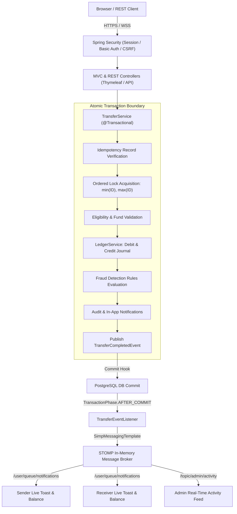
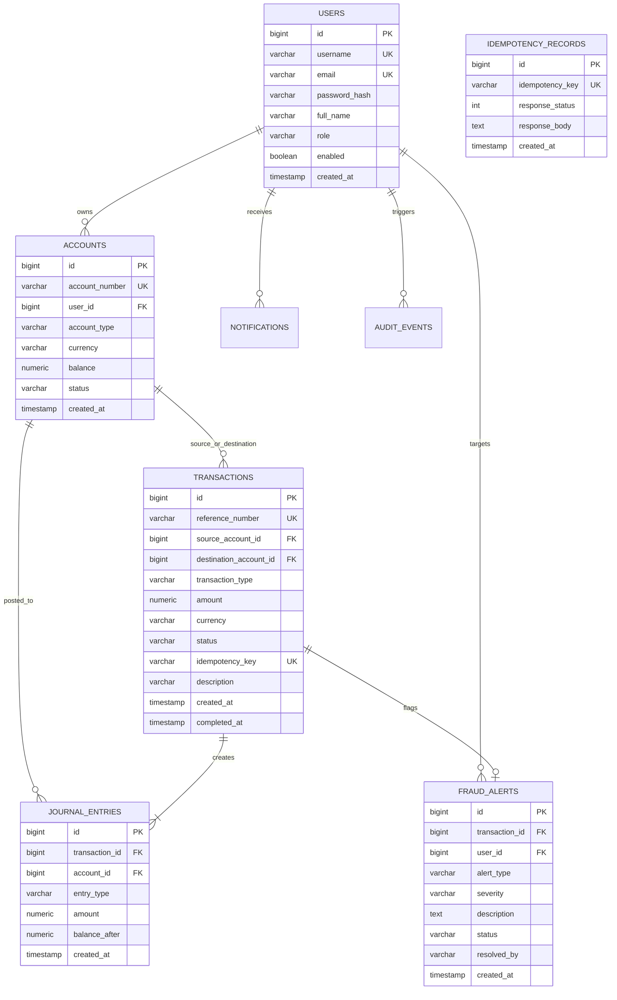

# FinCore — Real-Time Banking & Transaction Management System

FinCore is an enterprise-grade financial simulation platform built with **Java 21 LTS**, **Spring Boot 3.3.4**, **PostgreSQL 16**, and **Spring WebSocket (STOMP)**. It demonstrates rigorous double-entry accounting invariants, deadlock-free pessimistic concurrency control, idempotency key processing, real-time after-commit event distribution, and rule-based fraud detection.

---

## 1. Problem Statement
Traditional banking and ledger systems require zero margin for error:
- Race conditions during concurrent transfers can cause double-spending and overdrafts.
- Inconsistent debit and credit operations corrupt relational balance books.
- Network retries and duplicate API requests can charge customers multiple times without an idempotency safeguard.
- Real-time notifications distributed prematurely before database transactions commit can broadcast phantom transfers to users.

FinCore solves these real-world engineering challenges with strict relational ledger invariants, deterministic locking hierarchies, and an transactional event lifecycle.

---

## 2. Key Features
- **Double-Entry Ledger Integrity**: Every transfer generates paired debit and credit journal entries with balance snapshots. Invariant: `sum(debits) == sum(credits) == transfer_amount`.
- **Deadlock-Free Pessimistic Locking**: Eliminates database lock order inversion deadlocks during reciprocal transfers (A &rarr; B and B &rarr; A) by acquiring write locks in strict ascending order of Account ID.
- **Idempotency Protection**: Enforces unique idempotency keys on transfers to prevent duplicate processing from network timeouts or retry storms.
- **Transactional Outbox / After-Commit STOMP Real-Time Updates**: WebSocket messages are dispatched **only after** database commits via `@TransactionalEventListener(phase = AFTER_COMMIT)`.
- **Configurable Fraud Detection Engine**: Simulates transaction compliance rules, automatically flagging high-value transfers (&ge; ₹2,00,000) or high velocity bursts (&ge; 3 transfers in 60s) for administrative review without blocking genuine transfers.
- **Role-Based Access Control**:
  - `ROLE_CUSTOMER`: Accesses personal checking and savings accounts, executes transfers, views live debit/credit updates.
  - `ROLE_ADMIN`: Reviews system volume, inspects compliance alerts, approves/dismisses flagged transactions, and inspects the audit trail.
- **Modern Responsive UI**: Server-rendered Thymeleaf templates styled with Bootstrap 5 and custom CSS with live SockJS/STOMP toasts and dynamic table updates without page reloads.

---

## 3. Technology Stack
- **Backend**: Java 21 LTS, Spring Boot 3.3.4, Spring Web MVC, Spring Data JPA / Hibernate, Spring Security 6, Spring WebSocket (STOMP), Spring Boot Actuator, Jakarta Validation.
- **Database & Migrations**: PostgreSQL 16 (production/Docker), Flyway Database Migrations (`V1__init_schema.sql`, `V2__seed_demo_data.sql`), H2 (PostgreSQL compatibility mode for rapid testing).
- **Frontend**: Server-rendered Thymeleaf, Bootstrap 5, Bootstrap Icons, Vanilla JavaScript, SockJS, STOMP.js.
- **Testing**: JUnit 5, Mockito, Spring Boot Test, Spring Security Test.
- **Containerization**: Multi-stage Dockerfile, Docker Compose.

---

## 4. Architecture Overview

### System Architecture Diagram


### Entity-Relationship (ER) Diagram


---

## 5. Concurrency Control & Deadlock Prevention
When two users concurrently transfer to each other:
- User 1 transfers from Account 1 to Account 2.
- User 2 transfers from Account 2 to Account 1.

Under naive locking, Thread 1 locks Account 1 and waits for Account 2, while Thread 2 locks Account 2 and waits for Account 1, causing an instant cyclic deadlock!

**FinCore's Solution:**
```java
Long firstId = Math.min(srcLookup.getId(), dstLookup.getId());
Long secondId = Math.max(srcLookup.getId(), dstLookup.getId());

Account lockedFirst = accountRepository.findByIdForUpdate(firstId);
Account lockedSecond = accountRepository.findByIdForUpdate(secondId);
```
By acquiring pessimistic write locks (`SELECT ... FOR UPDATE`) in strict ascending numerical order of Account ID, cyclic wait graphs become mathematically impossible, eliminating deadlocks while ensuring atomic updates to balances.

---

## 6. Real-Time Communication Design
FinCore registers the STOMP endpoint at `/ws-fincore` with SockJS fallback.
- **Client Destination**: `/user/queue/notifications` (private to authenticated user principal).
- **Admin Topic**: `/topic/admin/activity` (restricted broadcast for administrative oversight).
- **After-Commit Guarantee**:
  ```java
  @TransactionalEventListener(phase = TransactionPhase.AFTER_COMMIT)
  public void handleTransferCompleted(TransferCompletedEvent event) {
      // Dispatched only after database guarantees commit
      messagingTemplate.convertAndSendToUser(event.getSenderUsername(), "/queue/notifications", ...);
  }
  ```

---

## 7. REST API Reference

| Method | Endpoint | Description | Auth | Headers |
|---|---|---|---|---|
| `POST` | `/api/v1/transfers` | Initiate fund transfer | Basic / Session | `Idempotency-Key` (Optional) |
| `GET` | `/api/v1/accounts` | Retrieve caller's accounts | Basic / Session | None |
| `GET` | `/api/v1/accounts/{accountNumber}` | Get specific account details | Basic / Session | None |
| `GET` | `/api/v1/transactions/{referenceNumber}` | Inspect transaction details | Basic / Session | None |
| `GET` | `/api/v1/transactions/account/{accountNumber}` | Paginated account transaction history | Basic / Session | None |

### Sample Transfer Request
```json
POST /api/v1/transfers
Content-Type: application/json
Idempotency-Key: 8a4b3c2d-9e1f-4a3b-b2c1-d4e5f6a7b8c9

{
  "sourceAccountNumber": "ACC-10001",
  "destinationAccountNumber": "ACC-20001",
  "amount": 5000.00,
  "currency": "INR",
  "description": "Invoice payment"
}
```

---

## 8. Demo Credentials & Running Locally

### Demo Accounts
- **Customer 1**: Username: `john_doe` | Password: `Customer@123` (Checking: `ACC-10001`, Savings: `ACC-10002`)
- **Customer 2**: Username: `jane_smith` | Password: `Customer@123` (Checking: `ACC-20001`)
- **Administrator**: Username: `admin` | Password: `Admin@123`

### Run with Maven Locally
```bash
cd portfolio-java-projects/fincore
mvn spring-boot:run
```
Access at `http://localhost:8080`.

### Run with Docker Compose
```bash
cd portfolio-java-projects/fincore
docker compose up --build -d
```

### Run Tests
```bash
cd portfolio-java-projects/fincore
mvn clean test
```

---

## 9. Interview Readiness & Resume Highlights

### Resume Bullets
- Architected **FinCore**, a high-concurrency banking ledger simulation in **Java 21** and **Spring Boot 3.3**, implementing strict double-entry journal balance invariants and PostgreSQL Flyway migrations.
- Eliminated reciprocal transaction lock inversion deadlocks by engineering a deterministic ascending-ID pessimistic write locking hierarchy under concurrent multi-threaded load.
- Designed an event-driven real-time notification engine using **Spring WebSocket (STOMP)** and `@TransactionalEventListener(phase = AFTER_COMMIT)`, guaranteeing zero phantom notifications on transaction rollback.

### Key Engineering Decisions
1. **Pessimistic Locking vs Optimistic Versioning**: For financial balances with frequent high-velocity updates, optimistic locking results in excessive retry aborts under contention. Pessimistic write locks (`SELECT FOR UPDATE`) serialized updates deterministically.
2. **Double-Entry Journal vs Simple Balance Mutation**: Storing debit and credit ledger rows alongside balances ensures auditability and mathematical balance verification.
3. **Ascending Account ID Locking**: Solved the classic dining philosophers / lock-inversion deadlock problem when Account A and Account B transfer to each other concurrently.
4. **AFTER_COMMIT Event Distribution**: Prevented race conditions between WebSocket delivery and database commit windows.
5. **Idempotency Record Layer**: Handled duplicate network requests transparently at the database boundary.
